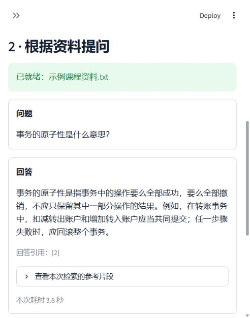

# 资料问答助手

基于 Python、LangChain、Streamlit 与阿里云百炼的课程作业。上传一份课程资料后，应用先检索相关片段，再让在线模型根据片段回答，并展示参考内容，便于人工核对。

开源仓库：https://github.com/305muleng/langchainWork

## 功能

- 读取文字型 PDF、UTF-8 TXT 和 Markdown；提供自带示例。
- 将资料切分成片段，调用百炼文本向量模型，建立当前会话的内存索引。
- 对问题检索最多 3 个相关片段，通过 LangChain 提示词、聊天模型与输出解析器生成回答。
- 资料不足时返回明确提示；校验回答引用编号是否对应本次检索结果。
- 展示来源文件、PDF 页码（如有）、片段内容和本次回答耗时。
- 支持清除资料与问答；更换资料、Key 或向量配置后，要求重新处理资料。
- 提供 Key 缺失、鉴权失败、超时、限流和文件格式错误的提示。

## 使用流程

上传资料 → 提取文字 → 切分片段 → 百炼向量化 → 内存索引 → 输入问题 → 检索片段 → 百炼生成回答 → 校验并展示引用。

这里使用检索增强生成（RAG），不训练或下载本地大模型，不需要独立向量数据库。

## 页面效果

## 技术与文件

| 组件 | 用途 |
| --- | --- |
| Python 3.13 | 本项目实际验证的运行版本 |
| LangChain Core / LangChain OpenAI | 文档、内存检索、提示词、模型适配和结构化输出解析 |
| LangChain Text Splitters | 中文文本切分，片段上限 800 字符，重叠 120 字符 |
| Streamlit | 文件上传、配置输入和问答页面 |
| pypdf | PDF 文字提取 |
| python-dotenv | 读取本地配置 |
| NumPy | 内存向量检索所需的数值计算 |
| 百炼 qwen-plus / text-embedding-v4 | 默认回答模型和向量模型，可配置 |

实际安装版本见 requirements.txt；全部依赖版本见 requirements.lock.txt。百炼账号需在对应地域拥有这两个模型的调用权限及可用额度。

目录：

~~~text
app.py                    页面与会话状态
rag.py                    文件读取、切分、检索和回答
verify_live.py            少量真实模型验收
run.cmd / run.ps1         Windows 启动入口
.env.example              不含 Key 的配置模板
requirements.txt          直接依赖
requirements.lock.txt     当前验证环境的全部依赖
examples/                 项目自编示例资料
tests/                    无真实 Key 的离线功能测试
docs/                     验证说明与页面截图
.venv/ .cache/ .tmp/ logs/ 本地运行文件，不提交到 GitHub
~~~

## 运行

本机目录为 D:\langchainWork，已有独立环境时不必重复安装，直接双击 run.cmd，或在 PowerShell 中执行：

~~~powershell
cd D:\langchainWork
.\run.cmd
~~~

随后打开 http://127.0.0.1:8501 。终止运行可在启动窗口按 Ctrl+C；关闭浏览器标签不等于关闭服务器。

首次从仓库运行时，需要先安装 Python。下面以本机现有的 Anaconda Python 为例；其他电脑应替换为自己的解释器路径：

~~~powershell
cd D:\langchainWork
New-Item -ItemType Directory -Force .tmp, .cache\pip | Out-Null
$env:TEMP = "$PWD\.tmp"
$env:TMP = $env:TEMP
& D:\Anaconda\python.exe -m venv --copies .venv
.\.venv\Scripts\python.exe -m pip --cache-dir .cache\pip install -r requirements.lock.txt
Copy-Item .env.example .env
~~~

依赖安装需要联网。锁定清单由 Windows / Python 3.13 环境生成，其他操作系统或 Python 版本未验收。

## 配置百炼

编辑本地 .env：

~~~dotenv
DASHSCOPE_API_KEY=填写你自己的Key
DASHSCOPE_BASE_URL=https://dashscope.aliyuncs.com/compatible-mode/v1
CHAT_MODEL=qwen-plus
EMBEDDING_MODEL=text-embedding-v4
~~~

也可以在页面左侧填写 Key，并展开“模型与接口”调整配置。页面填写的 Key 只保留在当前会话中，不写入 .env。

默认地址按北京地域配置；如果你的业务空间要求专属兼容地址，或使用其他地域，请以该业务空间控制台和官方文档为准。Key、地域与模型权限需要匹配。已登录百炼控制台不等于应用已具备 API 鉴权。

处理资料会产生文本向量调用；每次提问会产生问题向量和回答模型调用，消耗额度或产生费用。应用不会自动承诺调用免费。只在用户点击“处理资料”和“提问”时发起这些请求。

真实 .env、上传的私人资料、日志与独立环境不会提交到仓库。不要把 Key 填到源码或 README 中。

## 演示

1. 启动后填写自己的 Key。
2. 点击“使用示例资料”，预览提取的文字。
3. 点击“处理资料”，等待完成。
4. 提问“事务的原子性是什么意思？”。
5. 展开参考片段，检查回答与资料的对应关系。
6. 提问“这份资料所在学校明年的学费是多少？”，检查资料外问题的处理。
7. 点击“清除当前资料与问答”重置当前会话。

示例资料由本项目编写，不包含真实个人信息。每次提问独立检索，不会把上次回答作为事实依据；问“刚才那个是什么意思”时应补全具体对象。

## 验证

运行离线测试，不需要 Key，也不会调用真实模型：

~~~powershell
.\.venv\Scripts\python.exe -B -X utf8 -m unittest discover -s tests -v
~~~

真实模型验收需要有效的本地 Key，将对示例资料进行一次向量化、三次问题向量化和三次回答调用（请求失败时最多自动重试一次）：

~~~powershell
.\.venv\Scripts\python.exe -B -X utf8 verify_live.py
~~~

结果保存在 logs/live-check.json，不包含 Key。离线模拟测试不能证明真实百炼鉴权、模型权限、模型回答质量或网络可用；验收状态单独记录在 docs/verification.md。

## 限制

- 每次只处理一份资料；最大 10 MB、100 页 PDF、15 万字符、250 个片段。
- 暂不支持图片型扫描 PDF 的 OCR、加密 PDF、Word、表格与图片理解。
- 内存索引与最多 12 轮问答仅保留在当前会话，不提供历史持久化。
- 没有账号体系、多人协作或公网部署，仅监听本机 127.0.0.1。
- 检索出来的片段不一定与问题相关；“有引用”也不代表回答一定正确。提示词和结构化输出只能降低无依据回答，不能保证彻底消除幻觉或提示注入。
- 暂无人工标注的大规模评测，不声称生产可用或给出未经测量的准确率。
- 本地设置与模型服务变化都可能影响运行，故保留可配置模型和兼容接口地址。

## 本地文件与清理

本项目不修改系统 PATH，也不向 Anaconda 主环境安装包。启动脚本把应用使用的临时目录和已知缓存目录设置在项目目录内。独立环境仍依赖本机原有 Python 的基础运行文件，不是可随意移动到其他电脑的便携包。

完成作业后，先保存 GitHub 源码和需要的提交材料，停止相关进程，再删除 D:\langchainWork 即可清理该目录内的项目与环境。系统、浏览器、编辑器可能保留日志；百炼调用记录和 GitHub 仓库不会随本地文件夹删除。

## 参考

- [百炼接入 LangChain](https://help.aliyun.com/zh/model-studio/use-bailian-in-langchain)
- [百炼文本向量接口](https://help.aliyun.com/zh/model-studio/text-embedding-synchronous-api)
- [LangChain 官方文档](https://docs.langchain.com/oss/python/langchain/overview)
- [Streamlit 官方文档](https://docs.streamlit.io/)

## 许可

源码使用 MIT License。上传的资料由使用者自行确认是否拥有使用权限。
