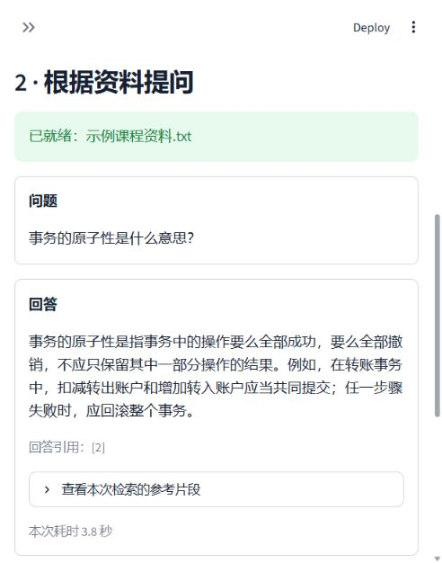

# 验证记录

日期：2026-10-31。项目范围为课程资料问答，不将以下有限样本外推为生产可靠性或总体准确率。

| 层次 | 结果 | 证据与边界 |
| --- | --- | --- |
| 独立环境 | 通过 | Python 3.13.5；pip check 无依赖冲突；关键模块可导入 |
| 离线功能与页面测试 | 17 项通过 | unittest；包含正常文字型 PDF 页码、扫描空白 PDF、页数和大小限制、文本编码、切分、配置变化、引用校验、缺失 Key、页面提问与清除 |
| 向量请求兼容性 | 本地协议测试通过 | 实际 OpenAIEmbeddings 客户端通过 MockTransport 验证每批最多 10 条、字符串输入和 float 编码；不是远程调用证据 |
| 百炼真实向量调用 | 通过 | text-embedding-v4 对自编示例建立 2 个片段的索引，并完成问题向量化 |
| 百炼真实回答调用 | 3 个示例符合预期 | qwen-plus；原子性、Cache Aside 两题有资料依据；资料外学费问题返回依据不足 |
| 浏览器实际操作 | 通过 | 本机浏览器选用示例、处理资料、提问、显示真实回答并展开参考片段核对；页面使用纯文字问题与回答标签，无表情头像 |
| 上传文件页面操作 | 通过 | 浏览器实际上传自编 TXT 文件并显示文件名、大小与提取结果；正常 PDF 提取及页码由离线测试验证 |
| 大规模回答质量、并发、多用户、生产部署 | 未验证 | 不在本次作业范围内 |

真实调用原始结果留在本地 logs/live-check.json，测试输出留在 logs/tests.log，均不上传仓库。模型输出存在变化，重新运行不保证措辞完全相同。

## 真实示例摘要

| 问题 | 实际结果 |
| --- | --- |
| 事务的原子性是什么意思？ | 回答操作整体提交或回滚，并引用支持该结论的片段 |
| Cache Aside 在缓存未命中时会怎么做？ | 回答查询数据库并回填缓存，附引用 |
| 这份资料所在学校明年的学费是多少？ | 明确说明资料中没有足够依据，不提供虚构金额 |

上述三题只验证有限场景；资料中的命令和恶意指令可能影响模型，系统提示不能保证彻底消除提示注入。

## 页面截图

以下为真实浏览器调用结果，使用自编示例资料，截图不包含明文 Key。

